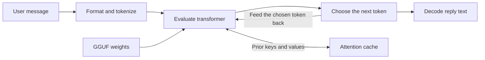

# How LMSharp runs a language model

LMSharp shows what happens between a prompt and the next token of a reply. The model file holds learned parameters. The C# application supplies the code that interprets those parameters and runs the model. This walkthrough uses one supported Phi-4 Mini checkpoint so you can trace the same tensor shapes and token IDs as the tests.



## 1. Load the model

[GgufReader](../src/LMSharp.Gguf/GgufReader.cs) parses the binary header, typed metadata, and tensor directory. [GgufTensorFile](../src/LMSharp.Gguf/GgufTensorFile.cs) computes the aligned data start, validates byte ranges, and reads tensor slices. A descriptor names a tensor and specifies its shape, storage type, and offset. The bytes in its payload encode the weights.

[Phi4WeightLayout](../src/LMSharp.Inference/Phi4WeightLayout.cs) and [Phi4Model](../src/LMSharp.Inference/Phi4Model.cs) check the shapes and model metadata before inference. GGUF is a container format. Executing another model family would require its own architecture, tokenizer, prompt format, and weight-type support.

## 2. Turn text into numbers

[Phi4Tokenizer](../src/LMSharp.Tokenization/Phi4Tokenizer.cs) wraps the message in the Phi-4 Mini chat format and reads the vocabulary and merge ranks embedded in the GGUF. The [byte-pair encoder](../src/LMSharp.Tokenization/BytePairEncoder.cs) represents text as bytes and repeatedly merges adjacent symbols according to those ranks. Added tokens represent roles and turn boundaries.

For the question `What is 2 + 2?`, the formatter produces this text.

```text
<|user|>What is 2 + 2?<|end|><|assistant|>
```

The tokenizer produces 11 input IDs.

```text
200021 4827 382 220 17 659 220 17 30 200020 200019
```

## 3. Predict the next token

Start with [Phi4Session](../src/LMSharp.Inference/Phi4Session.cs) for the CPU implementation. A token ID selects a row from the embedding matrix. The resulting vector passes through the model's 32 transformer layers. Each layer normalizes the input, projects queries, keys, and values, applies rotary position encoding, and combines information from positions up to the current token. A gated feed-forward network then transforms the state, with residual additions around attention and the feed-forward network.

After the final normalization, the model projects the state back to vocabulary size using the same weights as the input embeddings. Each output number is a *logit*, a score for a possible next token.

The initial evaluation of input tokens is called **prefill**. During prefill and subsequent decoding, each layer stores the keys and values produced at earlier positions. This **KV cache** allows attention to reuse them when evaluating a new token. LMSharp also uses it to carry earlier turns into later questions. The active context window limits the total number of input and output positions.

## 4. Choose a token and repeat

[Phi4Generator](../src/LMSharp.Inference/Phi4Generator.cs) passes logits to [TokenSampler](../src/LMSharp.Inference/TokenSampler.cs). At temperature zero, the sampler chooses the ID with the highest score. Higher temperatures sample from a probability distribution, and an optional seed makes the sequence of random choices repeatable for the same scores and settings.

For the example above, the first selected ID is `976`, which decodes to `The`. The engine feeds that ID back into the session to score the next token. It repeats until the model emits an end marker or reaches the reply limit. The tokenizer decodes the selected IDs back into text.

## CPU and CUDA paths

Both backends share the model profile, tokenizer, sampling code, and chat interface through [the model and session contracts](../src/LMSharp.Inference/IPhi4Model.cs).

- **CPU** keeps the packed weights in system RAM. [PackedMatrix](../src/LMSharp.Tensors/PackedMatrix.cs) unpacks weight blocks as needed to multiply them by an input vector. [GgmlDequantizer](../src/LMSharp.Tensors/GgmlDequantizer.cs) implements the storage formats used by the model.
- **CUDA** uploads the packed weights to VRAM. [CudaPhi4Session](../src/LMSharp.Inference/Cuda/CudaPhi4Session.cs) invokes [LMSharp's CUDA kernels](../src/LMSharp.Inference/Cuda/Phi4.cu) and keeps activations and the KV cache on the card. It returns logits to the shared C# sampler.

## Where to set a breakpoint

Start with the CPU backend and a Release run for normal use. For stepping through the C# code, use a Debug build with a short prompt and a small output limit. The [console entry point](../src/LMSharp.Console/Program.cs) dispatches `inspect`, `tokenize`, `generate`, and `chat`. Follow [Phi4Generator.Generate](../src/LMSharp.Inference/Phi4Generator.cs) into the CPU session, then look at how a sampled token becomes the next input. See [terminal usage](Usage.md) for the matching commands.
